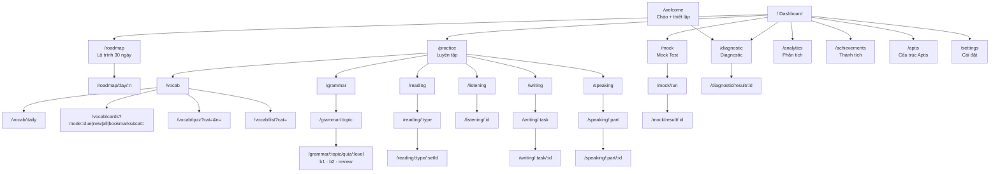

# 2. Sitemap

Điều hướng bằng hash (`#/đường-dẫn`), nên chạy được qua `file://`. Lần đầu (chưa hoàn tất thiết lập) mọi route đều chuyển về `#/welcome`, trừ `/aptis` và `/settings`.

## Bảng route

| Route | Màn hình | Ghi chú |
|---|---|---|
| `/welcome` | Chào + thiết lập nhanh | Lưu hồ sơ, đặt Ngày 1 = hôm nay |
| `/` | Dashboard | Tổng quan hôm nay |
| `/diagnostic` · `?form=A\|B` · `&run=1` | Giới thiệu / bắt đầu / làm bài | `run=1` mới bắt đầu tính giờ |
| `/diagnostic/result/:id` | Báo cáo Diagnostic | Xem lại câu sai chỉ có ngay sau khi làm |
| `/roadmap` · `/roadmap/day/:n` | Tổng quan 4 tuần · chi tiết ngày | n = 1..30 |
| `/practice` | Trung tâm luyện tập | 6 mô-đun |
| `/vocab` · `/daily` · `/cards` · `/quiz` · `/list` | Từ vựng | |
| `/grammar` · `/:topic` · `/:topic/quiz/:level` | Ngữ pháp | topic: 8 chủ điểm hoặc `all`; level: `b1` `b2` `review` |
| `/reading` · `/:type` · `/:type/:id` | Reading | type: `sentence` `ordering` `shortMatch` `longMatch` |
| `/listening` · `?type=` · `/:id` | Listening | |
| `/writing` · `/:task` · `/:task/:id` | Writing | task: 1–4 |
| `/speaking` · `/:part` · `/:part/:id` | Speaking | part: `p1`–`p5` |
| `/mock` · `?mode=mini\|full` | Tổng quan Mock | |
| `/mock/run` | Làm bài thi thử | Đọc `mockRun` trong LocalStorage |
| `/mock/result/:id` | Kết quả Mock | |
| `/analytics` · `/achievements` · `/aptis` · `/settings` | Các trang còn lại | |

Đường dẫn không tồn tại → trang "Không tìm thấy". Tham số lạ (ví dụ id sai) → chuyển về danh sách cha.

## Điều hướng
- **Desktop**: thanh bên trái (Dashboard, Lộ trình, Luyện tập + 6 mô-đun, Mock, Diagnostic, Phân tích, Thành tích, Cấu trúc Aptis, Cài đặt); thanh trên có Ngày X/30, streak, XP, chế độ tập trung, sáng/tối.
- **Mobile (< 960px)**: thanh dưới 6 mục (Trang chủ, Lộ trình, Luyện tập, Mock, Phân tích, Khác).
- **Chế độ tập trung**: ẩn thanh bên/dưới, thu hẹp nội dung, nút thoát nổi ở góc.
